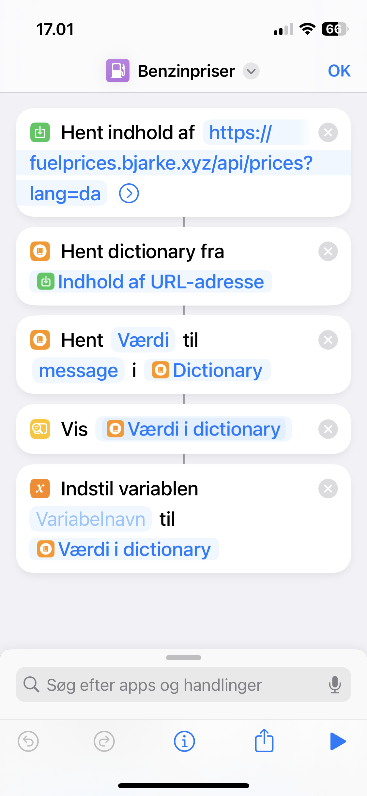

# Fuelprices

Frontend and HTTP API for getting fuel prices

https://fuelprices.bjarke.xyz/

A Go backend serving a React SPA. Prices are scraped from OK.dk and stored in a
local SQLite database. The frontend build is embedded into the binary, so a
deploy is a single static executable plus a writable volume for the database.

## Configuration

| Variable  | Default           | Description                                                                   |
| --------- | ----------------- | ----------------------------------------------------------------------------- |
| `DB_PATH` | `./fuelprices.db` | Path to the SQLite database. Created if absent.                               |
| `PORT`    | `3000`            | Port to listen on.                                                            |
| `JOB_KEY` | —                 | Shared secret for `POST /api/job`. Without it the endpoint rejects everything. |

## Development

```sh
npm ci
npm run dev-api   # Go API on :3000
npm run dev       # Vite dev server on :5173, proxying /api to the above
```

To run the production layout locally, `npm run build` to produce `dist/`, then
`go run .` — the binary serves the built frontend itself. Note that `go build`
requires `dist/` to exist, because it is embedded.

## API

- `GET /api/prices?now=<yyyy-mm-dd>&type=<fueltype>&lang=<da|en>` — a spoken-word
  summary plus yesterday's, today's and tomorrow's prices.
- `GET /api/price-trends?type=<fueltype>&from=<yyyy-mm-dd>&to=<yyyy-mm-dd>` —
  parallel arrays of dates and prices.
- `POST /api/job` with an `Authorization: <JOB_KEY>` header — scrapes OK.dk and
  records new and revised prices.

`fueltype` is one of `unleaded95` (the default), `octane100` or `diesel`.

Dates are stored as UTC midnight, and a day means a calendar day in
Europe/Copenhagen.

## Deployment

```sh
docker build -t fuelprices .
docker run -p 3000:3000 -v fuelprices-data:/data -e JOB_KEY=... fuelprices
```

The image runs as a non-root user, so the mounted volume must be writable by
uid 65532.

## iOS shortcut

iOS shortcut, so the API can be invoked using siri.


